# 🛡️ NETWORKWALKS-MALEKAROUA-B084-WK3-MALTEGO-OSINT

Building practical OSINT reconnaissance, Maltego link analysis, and passive infrastructure footprinting capabilities

---

## 📌 Project Overview
This project documents hands-on practical exercises completed during Week 3 of the NetworkWalks cybersecurity training program. The focus of this module is Passive Infrastructure Footprinting and Link Analysis using **Maltego (Desktop 4.13.0)** and **Kali Linux CLI utilities** to map target domain infrastructure, IP address resolutions, CIDR netblock boundaries, Autonomous System (AS) ownership, and domain privacy registrations without initiating intrusive or unauthorized active scans.

---

## 🎯 Objectives
The main goals of these practical labs are:
- Master graphical link analysis and entity pivoting workflows inside Maltego.
- Resolve target domain names to active IPv4 addresses using automated CTI and standard utility transforms.
- Determine network scope boundaries by expanding single host IPs into full CIDR netblocks.
- Identify Autonomous System (AS) owners and hosting providers managing target infrastructure.
- Differentiate between suspicious operational indicators and standard domain privacy protection services.
- Apply CLI workaround strategies (e.g., native `whois`) when API credit quotas or data provider limits are encountered.

---

## 🛡️ Scope & Authorization
> **⚠️ Disclaimer:** All reconnaissance activities were conducted strictly for educational purposes as part of the official NetworkWalks cybersecurity curriculum. All data collection relied exclusively on passive, publicly accessible domain registries, DNS resolvers, and WHOIS databases. No unauthorized access, active vulnerability scanning, or exploitation was performed against any target system.

---

## ⚙️ Environment & Tooling Summary

| Component | Specification / Setting |
| :--- | :--- |
| **Primary Environment** | Kali Linux (Rolling) / Maltego Desktop 4.13.0 |
| **Reconnaissance Technique** | Graphical OSINT Link Analysis & Passive Infrastructure Footprinting |
| **Transforms & APIs Used** | Maltego CTI (Cyber Threat Intelligence Data Pass), Utilities Transforms |
| **CLI Tooling** | Kali Linux `whois` utility |
| **Primary Target** | `networkwalks.com` |
| **API Limit Workarounds** | Custom WHOIS query regex / `[Utilities]` transforms |

---

## 📂 Project Structure & Modules

### Task 1: Maltego Installation & Environment Setup (`1.png`)
- Downloaded and configured Maltego Desktop on Kali Linux.
- Installed Maltego directly via APT package manager using terminal commands:
  ```bash
  sudo apt update
  sudo apt install maltego
  maltego

### Task 2: Graphical Entity Pivoting (Domain -> IP -> Netblock) (`12.png`)
- Constructed the initial graph by adding target domain node `networkwalks.com`.
- Executed `[CTI] Domain to IP Addresses` transform to resolve the target domain to its public IPv4 destination (`192.232.216.135`).
- Pivoted from host IP to map the allocated subnet range using `[Utilities] To Netblock [Using whois info]`.

### Task 3: API Quota Mitigation & Infrastructure Attribution (`run.png`)
- Managed Maltego Data Pass 200-credit monthly quota limits when automated CTI transforms triggered credit boundary errors.
- Bypassed API restrictions by switching to built-in `[Utilities]` transforms and native Kali Linux CLI utilities.
- Queried WHOIS databases via terminal regex filtering (`grep`) to extract network registration (`NetName`) and administrative ownership (`OrgName`).

### Task 4: Registration & Privacy Verification (`run2.png`, `run3.png`)
- Extracted registration contact entities and privacy proxy URLs.
- Analyzed the operational difference between public web contact listings and registry-masked WHOIS privacy proxies (GoDaddy).

---

## 📊 Lab Documentation & Findings

### Infrastructure Mapping Summary

| Target Domain | Resolved IP Address | CIDR Netblock Range | Network Owner / Provider | Registrar Privacy Status |
| :--- | :--- | :--- | :--- | :--- |
| `networkwalks.com` | `192.232.216.135` | `192.232.192.0/18`<br>(`192.232.192.0 - 192.232.255.255`) | `HostGator.com LLC`<br>(NetName: `HGBLOCK-8`) | Active (GoDaddy Privacy Proxy) |

---

### Security & Operational Impact
1. **Infrastructure Attribution:** Uncovering that `networkwalks.com` resolves to IP `192.232.216.135` within HostGator's `HGBLOCK-8` subnet allows security analysts to establish network baselines and identify co-located assets sharing the same netblock range.
2. **Privacy vs. Suspicious Indicators:** Seeing privacy-masked WHOIS contact endpoints (GoDaddy proxy nodes) is standard enterprise cybersecurity hygiene designed to prevent spam harvesting, rather than an automatic indicator of malicious intent.

---

## 🖼️ Evidences Collected

### 1. Maltego Installation & Setup 

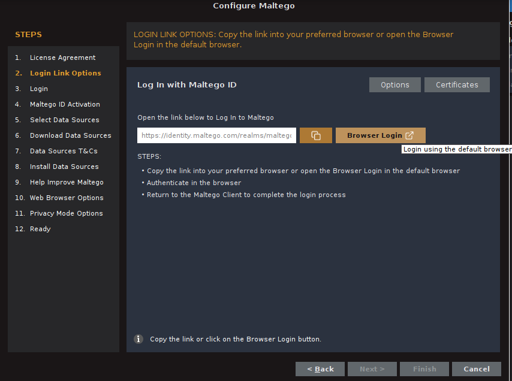
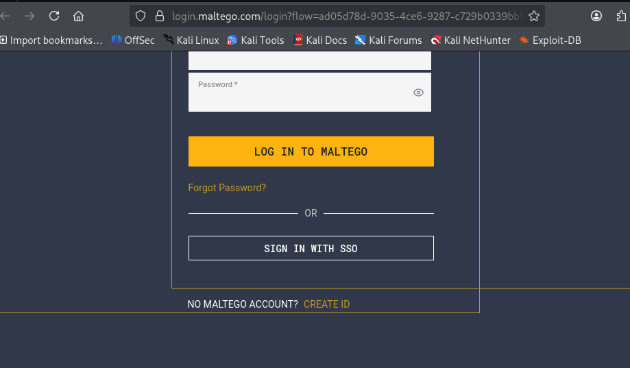
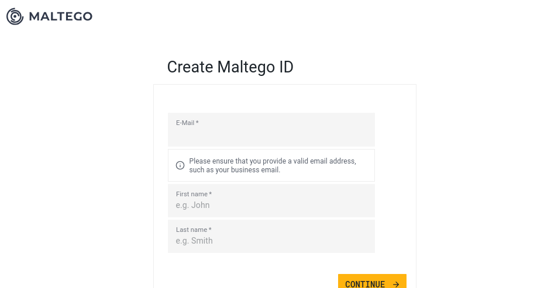
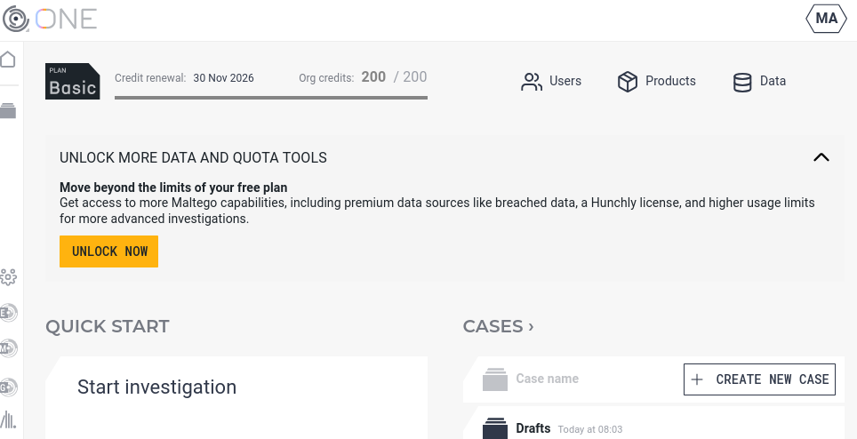
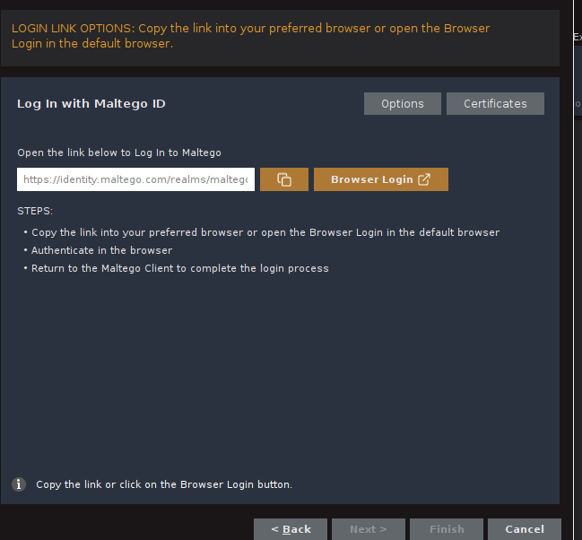
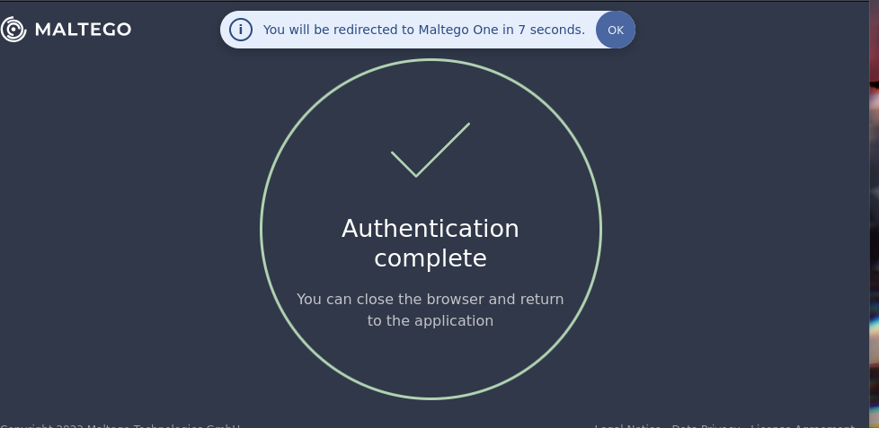
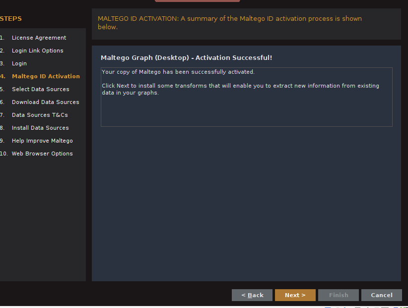
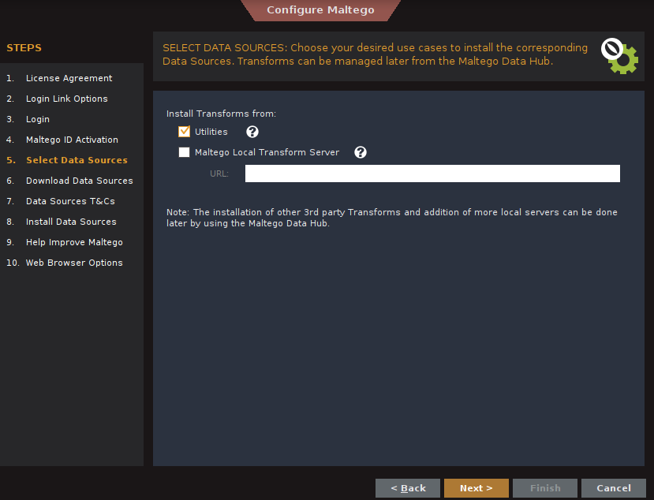
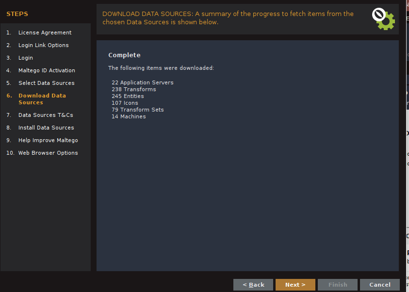
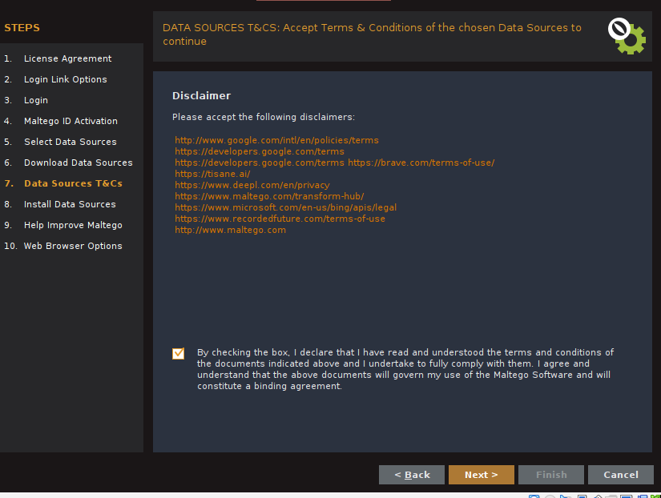

### 2. Initial Maltego Graph Resolution 
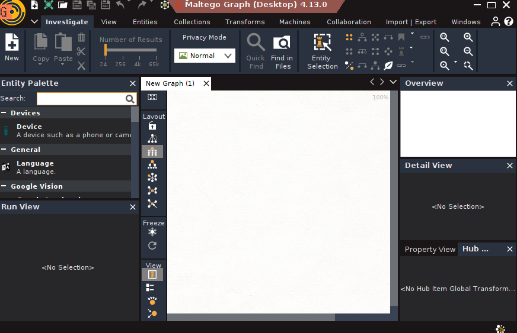
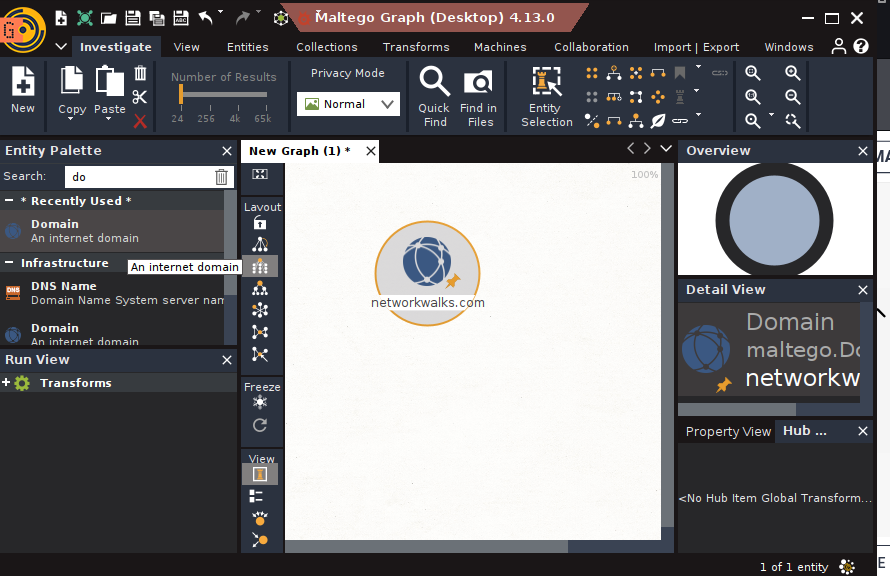
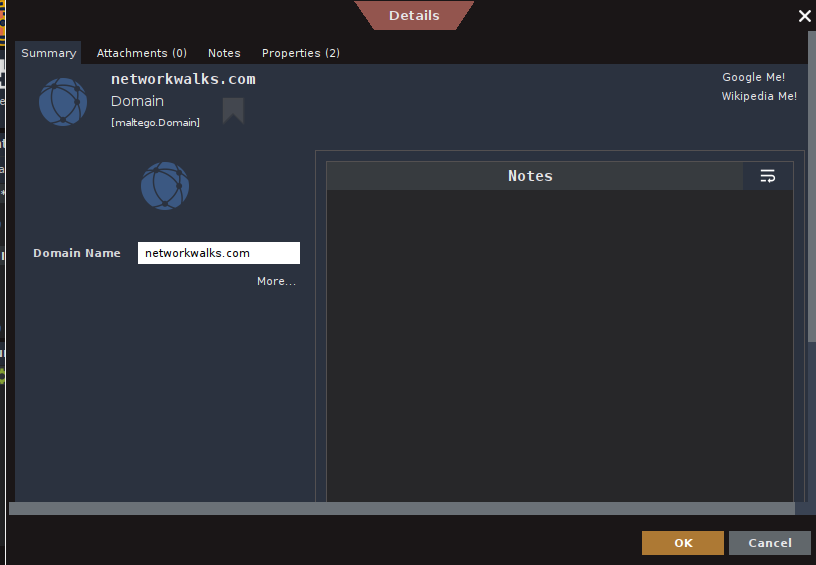

### 3. Maltego CTI Quota Limit Alert 
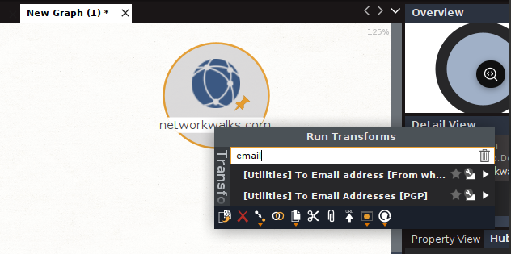
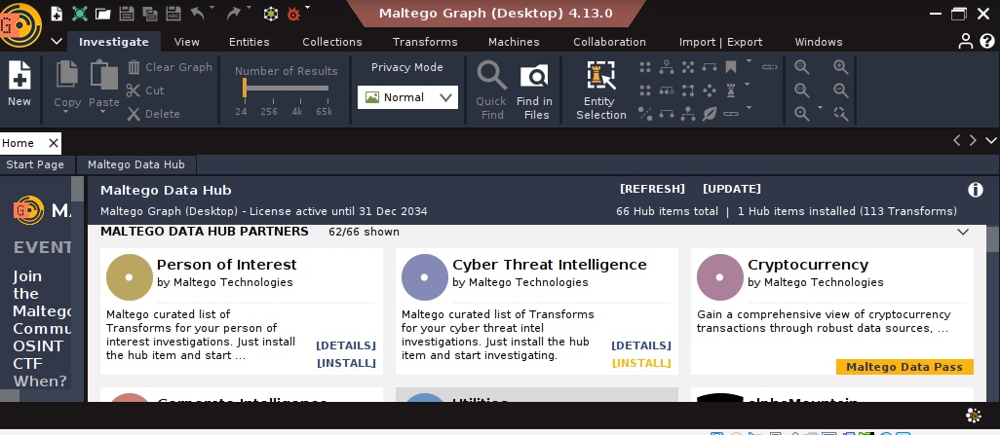
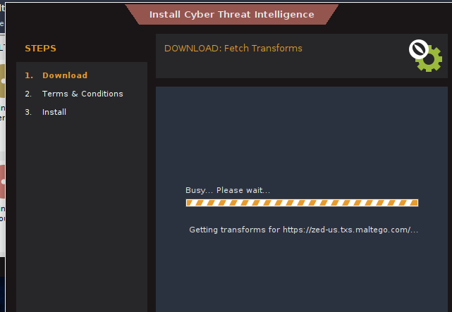
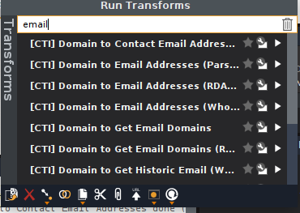
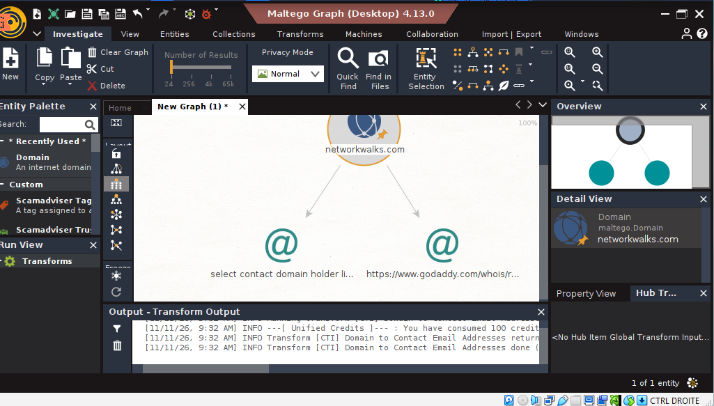

### 4. Netblock Resolution via Utilities Transform 
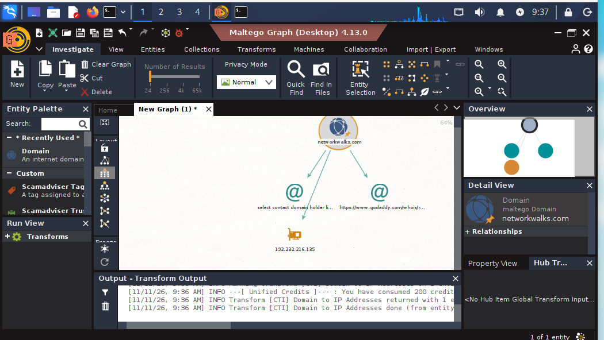
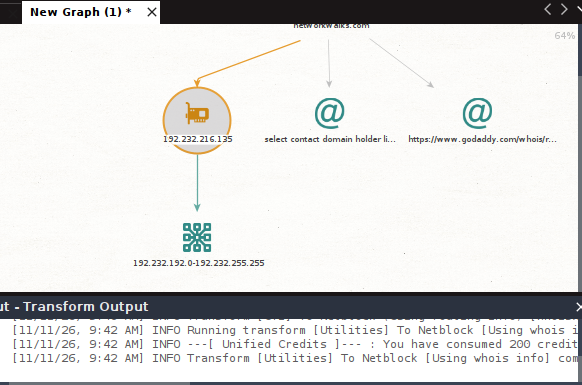

### 5. CLI Infrastructure Verification 
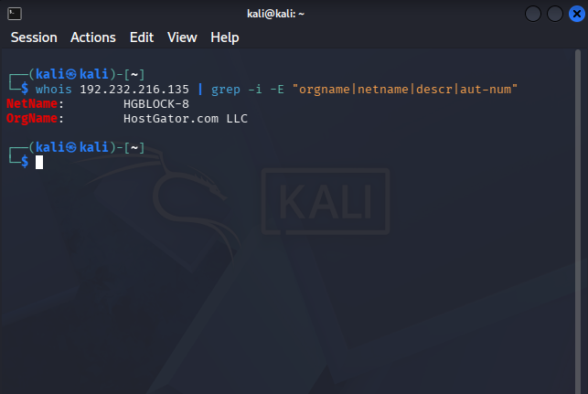

## 💡 What I Learned

1. **The Power of Passive OSINT & Link Analysis:**  
   Graphical mapping allows security analysts to visualize complex relationships between abstract domains, raw IP addresses, subnets, and organization entities in a unified workspace without sending active probes.

2. **Resource & Quota Adaptability:**  
   Relying solely on paid or credit-restricted CTI API feeds can stall an investigation. Knowing how to seamlessly pivot to open-source CLI utilities (`whois`, `dig`, `nslookup`) ensures continuous reconnaissance without data gaps.

3. **Contextual Evaluation of Privacy Services:**  
   Identifying domain privacy protection features (such as GoDaddy privacy proxies) does not inherently indicate malicious intent; rather, it is a standard privacy practice used by legitimate web administrators to shield personal contact details from scrapers.

4. **End-to-End Pivoting Methodology:**  
   Mastered the structural flow of infrastructure reconnaissance, stepping logically from target domain name down to hosting provider networks:

   ```text
   Target Domain  --->  IP Address  --->  CIDR Subnet Range  --->  AS Infrastructure Owner

  ## 🔗 Resources & References
- **NetworkWalks Cybersecurity Curriculum (Batch B084)**
- **Maltego Official Documentation & Transform Hub:** https://docs.maltego.com/
- **ARIN / WHOIS IP Lookup Registry:** https://whois.arin.net/

---

## 👤 Author
**Malek Aroua**  
Computer Networks Graduate | Cybersecurity Specialist  
*Project completed as part of the NetworkWalks Cybersecurity Certification Program (Batch B084).*
